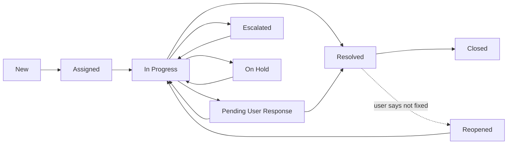

# 🔄 Ticket Status Flow

[ Back to Overview] → [README.md](./README.md)

---

> **Lab Note:** The ticket, the names and the times in the example are illustrative. Real ticketing tools use their own status names, so the statuses below are the common ones.

## 📋 Summary

A ticket moves through a series of **statuses** from the moment it is raised until it is closed. The status tells everyone who has to act next, and it controls the SLA clock in many systems. This file lists the common statuses and follows one ticket through them.

---

## 🗂️ Status Reference

| Status | Meaning | Who acts next |
|--------|---------|---------------|
| 🔵 **New** | The ticket was just raised and nobody has picked it up | The IT team assigns it to a technician or a queue |
| 🔵 **Assigned** | The ticket is given to a technician or team | The technician picks it up |
| 🟠 **In Progress** | The technician is working on the issue | The technician investigates and applies the fix |
| 🟣 **Pending User Response** (waiting for user) | The technician needs information from the user, or waits for the user to confirm the fix | The user must reply |
| 🟡 **On Hold / Pending Third Party** | The work is blocked, for example waiting for a part, an approval or a supplier | Whoever the ticket waits for |
| 🔴 **Escalated** | Tier 1 cannot fix it in time or at all, so it passes to Tier 2 or a senior technician | Tier 2 or the senior technician takes over |
| 🟢 **Resolved** | The issue is fixed, and the user was told or confirmed | The ticket is closed, by the technician, by the user's confirmation, or automatically after a few days |
| ⚫ **Closed** | The ticket is complete, with no further action | Nobody. The ticket is kept for reports |
| 🔁 **Reopened** | The problem came back, or the user says the fix did not work | The technician or team picks it up again |

> **Escalated** is a status in some tools. In others, escalating means **reassigning** the ticket to a Tier 2 queue while the status stays **In Progress**. Either way, record the reason in the ticket notes.

---

## 🔀 Status Flow

---

## ⏱️ Statuses and the SLA Clock

| Status | SLA clock |
|--------|-----------|
| **New, Assigned, In Progress, Escalated** | Runs |
| **Pending User Response** | Often **paused** while the technician waits for the user |
| **On Hold / Pending Third Party** | Often paused, if the SLA allows it |
| **Resolved, Closed** | Stops (the exact point depends on the SLA) |

> Each SLA defines which statuses pause the clock. Check yours before you rely on this table. Do not leave a ticket in **Pending User Response** only to stop the clock. Use it when you really are waiting for the user.

---

## 🕒 Example - Incident INC-00452

| Time | Status | What happened |
|------|--------|---------------|
| 🔵 **09:15** | **New** | Sarah Jones raises a ticket: "Outlook will not open" |
| 🟠 **09:20** | **In Progress** | John picks up the ticket and starts Outlook in safe mode (`outlook.exe /safe`). It opens, so an add-in is the likely cause |
| 🟠 **09:35** | **In Progress** | John turns off the add-ins one at a time, finds the faulty one, and leaves it off |
| 🟣 **09:45** | **Pending User Response** | The fix is applied. John asks Sarah to open Outlook normally and confirm |
| 🟢 **10:00** | **Resolved** | Sarah confirms Outlook is working |
| ⚫ **10:05** | **Closed** | John closes the ticket with the resolution notes: *a faulty add-in was turned off, and Outlook opens normally* |

**Resolution note for the ticket:**

| Field | Entry |
|-------|-------|
| **Cause** | A faulty Outlook add-in stopped Outlook from starting |
| **Action** | Started Outlook in safe mode and turned off the faulty add-in |
| **Confirmation** | The user confirmed that Outlook opens normally |

---

## 💡 Next Step

→ [Ticket Priority Levels](./ticket-priority-levels.md)

